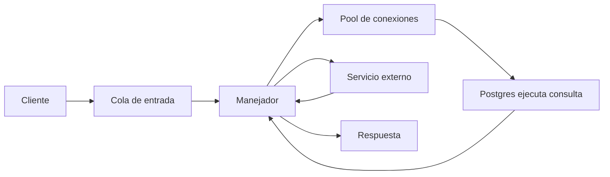
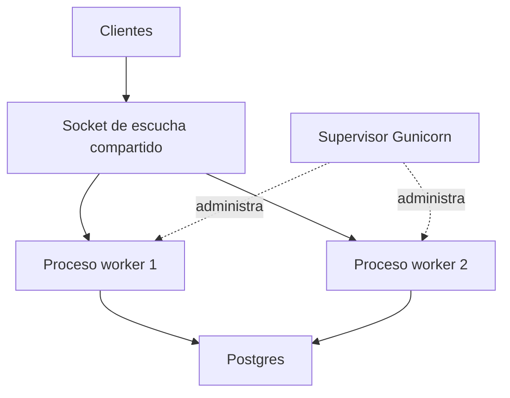
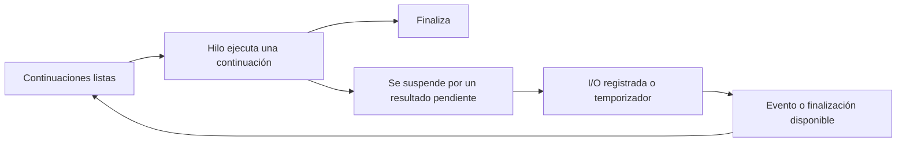
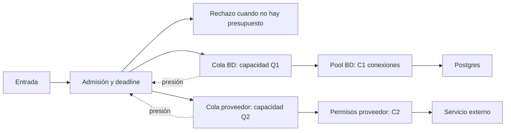
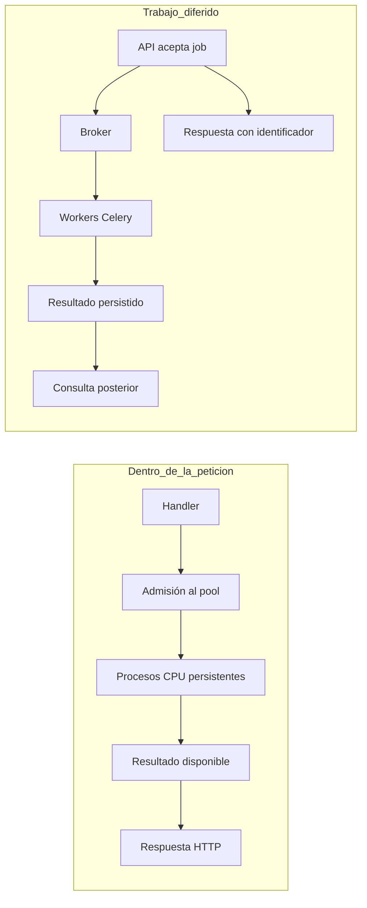
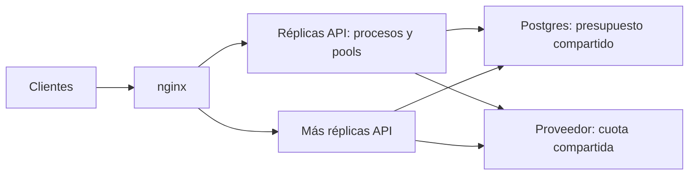

**Propongo una unidad donde cada modelo de ejecución cambie explícitamente el diseño del servidor:** qué trabajo admite, qué recurso ocupa, dónde espera y cómo responde cuando se satura.

No guardé un archivo: falta la ruta de salida y este entorno solo permite lectura. Entrego el contenido completo abajo. No modifiqué el repo ni ejecuté benchmarks o pytest.

**1. Ubicación y criterio editorial**

Destino propuesto para la nueva unidad: `course/11_computo_y_concurrencia/`, conservando el identificador `computo-y-concurrencia`. La numeración es una propuesta; debe coordinarse con el replanteo general.

Cada concepto debe terminar, **antes del código**, con este bloque:

1. Qué decisión arquitectónica permite tomar.
2. Dos a cuatro patrones con sus límites.
3. Un diagrama con recursos, colas y fronteras de proceso.
4. Un caso concreto y una condición que haría cambiar la decisión.

Usaría un caso conductor: **una API de ventas consulta Postgres, obtiene información de otro servicio y, cuando corresponde, genera un reporte**. Los ejemplos siguientes son diseños propuestos con software real; no descripciones de despliegues existentes.

El índice actual, [0_index.md](/home/uumami/itam/fdd_o26/course/10_apis/2_computo_y_concurrencia/0_index.md), excluye expresamente timeouts, colas y escalado. Esa exclusión debe desaparecer: aquí son consecuencias del modelo de ejecución, aunque otras unidades profundicen en protocolos y operación.

**2. Acuerdos matemáticos que necesitan los diagramas**

Antes de dibujar arquitectura, fijaría estas convenciones con quien redacte el marco matemático:

| Punto | Convención necesaria |
|---|---|
| Unidad de trabajo | Cada \(\tau_i\) representa un flujo secuencial. Si una petición se divide en subtareas, dibújalas y nómbralas por separado. |
| Ciclo de vida | Usa intervalos \([start(\tau_i),end(\tau_i))\). Dos tareas consecutivas no son concurrentes por compartir un extremo. |
| Paralelismo | Con las mismas tareas y el mismo alcance, **paralelo implica concurrente**: \(\mathcal P\subseteq\mathcal C\). La celda «paralelo sin concurrente» queda vacía. |
| Recursos | \(P\): capacidad de ejecución del modelo; \(m\): procesos; \(h\): hilos; \(C\): límite de operaciones simultáneas; \(Q_{\max}\): capacidad de una cola. No son intercambiables. |
| Estados | Separa ejecución, espera de I/O, espera por recurso —pool, candado— y tarea lista esperando CPU. `exec + wait_IO` no describe todo el tiempo bajo contención. |
| Alcance | «El servidor espera Postgres» puede coincidir con «Postgres ejecuta la consulta». La espera siempre tiene un observador. |
| CPU-bound / I/O-bound | Describen qué recurso domina o limita una carga; no equivalen a `wait = ∅` y `wait ≠ ∅`. |
| Asincronía | Es un contrato de inicio y finalización desacoplados. La presencia de espera, por sí sola, no define una interfaz asíncrona. |

Para latencia, distingue llegada \(a_i\), comienzo de atención \(s_i\) y finalización \(f_i\):

\[
R_i=f_i-a_i
=\underbrace{s_i-a_i}_{\text{cola de entrada}}
+\underbrace{f_i-s_i}_{\text{atención, incluidas sus esperas}}.
\]

Si modelas la llegada como inicio de la tarea, llama **secuencial al servicio del worker**: varias peticiones pueden estar pendientes simultáneamente en su cola. No cambies silenciosamente la frontera de medición.

Estas correcciones afectan especialmente a:

- [02_secuencial.md de p26](/home/uumami/itam/fdd_p26/clase/16_computo/02_secuencial.md).
- [05_paralelismo.md de p26](/home/uumami/itam/fdd_p26/clase/16_computo/05_paralelismo.md): la demostración expresa la implicación correcta, pero el símbolo de inclusión está invertido.
- [2_concurrente_paralelo_asincrono.md actual](/home/uumami/itam/fdd_o26/course/10_apis/2_computo_y_concurrencia/2_concurrente_paralelo_asincrono.md): el ejemplo de NumPy cambia el nivel de detalle para ocupar la celda imposible.

**3. Contenido arquitectónico por concepto**

**3.1. Secuencial: preservar dependencias y limitar complejidad**

La decisión inicial es qué operaciones **deben** suceder en orden y cuáles solamente quedaron escritas en orden.

| Patrón | Cuándo sí | Cuándo no | Qué significa en un diagrama | Ejemplo concreto |
|---|---|---|---|---|
| Cadena de operaciones dependientes | El siguiente paso necesita el resultado anterior. | Las operaciones son independientes y su suma de latencias incumple el objetivo. | `A → B → C`; cada flecha representa una dependencia de datos. | Un cliente Node obtiene una página y usa su cursor para pedir la siguiente. |
| Atención secuencial por worker | Carga moderada, manejadores simples y duración controlada. | Conexiones prolongadas o esperas que ocupan todos los workers. | Una caja de worker con una petición activa; las demás esperan fuera. | Gunicorn con workers `sync`; cada worker atiende una petición a la vez. |

Gunicorn permite enseñar una distinción desde el inicio: **un worker puede ser secuencial mientras el servidor completo atiende peticiones concurrentemente**. Su arquitectura utiliza varios procesos administrados por un proceso supervisor. [Diseño de Gunicorn](https://gunicorn.org/design/).

Ejercicio de arquitectura: marca qué flechas de `validar → consultar → calcular → responder` son dependencias inevitables y cuáles podrían separarse.

**3.2. Tiempo de ejecución y espera: identificar qué recurso queda ocupado**

Esperar una respuesta no implica que todos tus recursos queden disponibles. Puedes liberar CPU y conservar una conexión, memoria, un hilo o un candado.

| Patrón | Cuándo sí | Cuándo no | Qué significa en un diagrama | Ejemplo concreto |
|---|---|---|---|---|
| Pool de conexiones reutilizables | Muchas operaciones usan el mismo destino y abrir conexiones tiene costo. | Se pretende arreglar una consulta lenta aumentando conexiones sin revisar la capacidad de la BD. | `solicitantes → espera de préstamo → C conexiones → BD`. | `psycopg_pool` frente a Postgres. |
| Deadline de extremo a extremo | La petición tiene un tiempo máximo útil para el cliente. | Se concede el timeout completo nuevamente a cada paso y reintento. | Un presupuesto abarca cola, adquisición, consulta y respuesta. | API con límite total; adquisición del pool y consulta usan presupuestos menores. |
| Liberación temprana de recursos | Puedes terminar una operación antes de iniciar otra independiente. | Necesitas conservar una transacción o instantánea por corrección. | La flecha «devolver conexión» aparece antes de llamar al servicio externo. | Leer ventas, devolver la conexión a Postgres y después consultar otro servicio. |

El pool de Psycopg distingue tamaño, tiempo máximo para obtener una conexión y cantidad de solicitantes en espera. PostgreSQL distingue `statement_timeout` de `lock_timeout`; ninguno representa por sí solo el tiempo total de una petición HTTP. [Pool de Psycopg](https://www.psycopg.org/psycopg3/docs/api/pool.html), [timeouts de PostgreSQL](https://www.postgresql.org/docs/current/runtime-config-client.html).

Pregunta de diseño: **mientras esta petición espera, qué recursos conserva y quién más los necesita**.

**3.3. Concurrente: aceptar trabajo solapado exige controlar recursos**

Concurrencia significa que varios trabajos permanecen en curso. No promete ejecución simultánea ni capacidad ilimitada.

| Patrón | Cuándo sí | Cuándo no | Qué significa en un diagrama | Ejemplo concreto |
|---|---|---|---|---|
| Un hilo por conexión | Demostración o servicio pequeño con conexiones controladas y operaciones bloqueantes. | Clientes numerosos o lentos pueden provocar crecimiento sin límite de hilos. | Cada conexión aceptada tiene un hilo; comparten memoria. | `ThreadingHTTPServer` del curso. |
| Pool reutilizable de workers | Quieres limitar ejecutores y amortizar su creación. | Confundes un número fijo de workers con una cola automáticamente acotada. | `admisión → cola → h workers`; el límite de cola se dibuja aparte. | Gunicorn `gthread`, acompañado por una política de admisión. |
| Bulkhead: presupuestos separados | Una dependencia lenta no debe consumir los recursos reservados a otra. | La carga es pequeña y el aislamiento solo introduce capacidad ociosa y complejidad. | Dos ramas con pools, cupos y esperas independientes. | API con presupuestos separados para Postgres y un proveedor HTTP. |

Un bulkhead limita cuánto puede propagarse la saturación. Separar dos semáforos ayuda, pero ambas ramas todavía pueden compartir CPU, memoria o un executor que se sature. [Patrón bulkhead](https://learn.microsoft.com/en-us/azure/architecture/patterns/bulkhead).

El servidor docente sirve para mostrar el primer patrón; la documentación de Python no lo recomienda como servidor de producción. [Servidores HTTP de Python](https://docs.python.org/3/library/http.server.html).

**3.4. Paralelo: distinguir acelerar una petición de atender más peticiones**

| Patrón | Cuándo sí | Cuándo no | Qué significa en un diagrama | Ejemplo concreto |
|---|---|---|---|---|
| División y reunión de un cálculo | Hay partes independientes suficientemente grandes. | Copiar datos, coordinar y reunir resultados cuesta tanto como calcular. | Una petición se divide entre procesos y vuelve a una barrera de reunión. | Reporte dividido por particiones en un `ProcessPoolExecutor` persistente. |
| Procesos que atienden peticiones independientes | Hay demanda simultánea y CPU disponible. | El cuello está en una BD o dependencia compartida. | Distintas peticiones ocupan distintas cajas de proceso. | Varios workers Gunicorn `sync`. |
| Workers especializados en tareas CPU | El trabajo necesita recursos o escalado distintos del servidor HTTP. | La tarea es breve y el costo de trasladarla domina. | Servidor HTTP y workers CPU tienen colas y presupuestos separados. | Workers Celery con pool `prefork`. |

Celery ofrece `prefork` como modelo de concurrencia basado en procesos. Eso no convierte automáticamente una tarea individual en un cálculo dividido. [Concurrencia de Celery](https://docs.celeryq.dev/en/stable/userguide/concurrency/index.html).

La figura debe identificar **cuáles \(\tau_i\)** ejecutan simultáneamente. Una caja rotulada «4 procesos» solo muestra capacidad potencial.

**3.5. Asíncrono: separar la espera del resultado de la ocupación del ejecutor**

| Patrón | Cuándo sí | Cuándo no | Qué significa en un diagrama | Ejemplo concreto |
|---|---|---|---|---|
| Inicio de varias operaciones y reunión —fan-out/fan-in— | Necesitas resultados de consultas independientes. | Hay dependencias entre consultas o el destino no soporta la carga adicional. | Bifurcación hacia operaciones independientes y reunión antes de responder. | API Uvicorn que consulta tres servicios con clientes asíncronos. |
| Trabajo diferido con identificador | El usuario puede recibir el resultado después y el trabajo excede el presupuesto HTTP. | La respuesta necesita el resultado definitivo de inmediato. | `POST → aceptación`; otro recorrido lleva del job al resultado consultable. | API + broker + Celery + almacenamiento del reporte. |
| Productor con cola acotada | La producción puede adelantarse temporalmente al consumo. | El exceso de llegada es permanente o se exige respuesta inmediata sin espera. | Cola con \(Q_{\max}\) y señal de pausa o rechazo al productor. | `asyncio.Queue(maxsize=...)` en un pipeline de adquisición. |

**Dos escalas distintas:** una corrutina suspendida vive dentro del proceso; un job en un broker pertenece a un contrato entre componentes. El segundo necesita definir persistencia, estados, fallos y duplicados.

Una cola acotada produce backpressure cuando obliga al productor a reducir o detener la producción. Si el origen no puede detenerse, necesitas una política explícita de rechazo. `asyncio.Queue` permite esperar cuando se llena, pero no es almacenamiento durable. [Colas de asyncio](https://docs.python.org/3/library/asyncio-queue.html).

**3.6. Hilos, procesos y GIL: elegir memoria compartida y fronteras de aislamiento**

| Patrón | Cuándo sí | Cuándo no | Qué significa en un diagrama | Ejemplo concreto |
|---|---|---|---|---|
| Hilos para bibliotecas bloqueantes | Debes integrar un cliente síncrono que pasa tiempo esperando I/O. | Esperas acelerar bytecode Python intensivo en CPU bajo un mismo GIL. | Varios hilos dentro de una caja de proceso y memoria compartida. | Gunicorn `gthread` o un executor de hilos para un cliente legado. |
| Prefork o multiproceso | Necesitas varios intérpretes, ejecución CPU o separación de fallos. | El consumo de memoria y los recursos duplicados exceden el presupuesto. | Procesos separados; cada uno tiene sus conexiones y estado local. | Gunicorn usa prefork; el gestor integrado de Uvicorn usa `spawn`. |
| Estado compartido protegido | Varias tareas modifican un mismo invariante. | Un candado global serializa todo el trabajo o se pretende coordinar procesos mediante un candado local. | Una sección crítica pequeña o una operación atómica en almacenamiento compartido. | Contador local con lock; actualización compartida mediante una operación transaccional en Postgres. |

Declara el supuesto: **CPython con GIL habilitado**. El GIL limita la ejecución de bytecode por intérprete; extensiones nativas pueden liberarlo y existen compilaciones sin GIL. No protege invariantes completos de tu aplicación. [Hilos y GIL](https://docs.python.org/3/library/threading.html).

No etiquetes todo multiproceso como prefork. La distinción Gunicorn/Uvicorn está documentada. [Despliegue de Uvicorn](https://uvicorn.dev/deployment/).

**3.7. Event loop: explicar quién registra, quién espera y quién reanuda**

| Patrón | Cuándo sí | Cuándo no | Qué significa en un diagrama | Ejemplo concreto |
|---|---|---|---|---|
| Multiplexación de I/O | Muchas conexiones pasan tiempo esperando y cada tramo de ejecución es breve. | Los manejadores realizan cálculo largo o llamadas bloqueantes en el hilo del loop. | Un hilo ejecuta continuaciones; el sistema operativo informa disponibilidad de I/O. | Uvicorn; nginx también utiliza un modelo orientado a eventos en sus workers. |
| Loop que delega trabajo bloqueante | Debes conservar la respuesta HTTP mientras otro ejecutor realiza una operación. | El envío al executor acumula trabajo sin control o se crea el pool por petición. | `loop → admisión → executor → finalización → loop`. | `run_in_executor` con un pool elegido explícitamente. |
| Control de flujo al escribir | Un cliente consume datos más despacio de lo que el servidor los produce. | Acumulas indefinidamente la respuesta en memoria. | Buffer con umbral y flecha que pausa la producción. | Control de escritura de Uvicorn. |

nginx combina varios procesos worker con atención orientada a eventos. Uvicorn documenta control de flujo y límites de concurrencia; su backlog de conexiones pendientes es otro mecanismo. [Arquitectura de nginx](https://nginx.org/en/docs/beginners_guide.html), [comportamiento de Uvicorn](https://uvicorn.dev/server-behavior/).

Explicación mínima del loop, antes de cualquier sintaxis:

1. Ejecuta una continuación lista.
2. Si necesita un resultado pendiente, registra cómo reanudarla y devuelve el control.
3. Atiende otra continuación o espera eventos.
4. La disponibilidad de I/O, un timer o una finalización vuelve elegible la continuación.
5. La reanuda cuando obtiene turno.

**`await` no garantiza suspensión:** un resultado ya disponible puede permitir continuar. Una función `async` que calcula mucho puede ocupar el hilo durante todo ese cálculo.

`run_in_executor(None, ...)` utiliza un executor de hilos por omisión. Para delegar CPU a procesos, el pool debe ser explícito. Delegar mueve el trabajo; no elimina su costo ni su cola. [Executors y event loop](https://docs.python.org/3/library/asyncio-eventloop.html#executing-code-in-thread-or-process-pools).

**3.8. Vectorización: cambiar la unidad de trabajo y el movimiento de datos**

| Patrón | Cuándo sí | Cuándo no | Qué significa en un diagrama | Ejemplo concreto |
|---|---|---|---|---|
| Operaciones sobre bloques | El cálculo puede expresarse sobre arreglos y amortiza conversiones. | Preparar el bloque cuesta más que la operación o domina lógica irregular por elemento. | `datos → arreglo → operación nativa → resultado`; desaparecen llamadas Python por elemento. | NumPy para transformar columnas de ventas. |
| Lotes acotados por tamaño y tiempo | Procesar juntos varios elementos mejora eficiencia sin incumplir latencia. | Esperar a llenar el lote perjudica peticiones interactivas. | Acumulador con dos disparadores: tamaño máximo y espera máxima. | Worker que procesa fragmentos de un archivo con NumPy. |
| Presupuesto conjunto de paralelismo | Combinas procesos de aplicación y bibliotecas numéricas con hilos internos. | Cada capa intenta utilizar todos los recursos sin considerar las demás. | Dentro de cada proceso aparecen sus hilos nativos y el presupuesto total. | NumPy con BLAS bajo varios workers. |

NumPy puede liberar el GIL; algunas operaciones de álgebra lineal delegan en BLAS multihilo. **Vectorización, SIMD y múltiples hilos son propiedades diferentes.** [Seguridad entre hilos de NumPy](https://numpy.org/doc/stable/reference/thread_safety.html), [configuración de hilos de BLAS](https://numpy.org/doc/stable/reference/global_state.html).

Incluye dos consecuencias arquitectónicas:

- Una operación nativa larga invocada directamente desde el loop sigue ocupando ese hilo, aunque libere el GIL.
- Si el conjunto completo no cabe en memoria, considera procesamiento por bloques; no descartes automáticamente la vectorización.

**3.9. Amdahl: decidir qué parte merece optimización**

Para un trabajo fijo, con fracción secuencial \(s\), reparto ideal y sin sobrecostos:

\[
S(P)=\frac{1}{s+(1-s)/P}.
\]

Con \(s=0.25\) y \(P=4\), el máximo ideal es aproximadamente \(2.29\times\); el límite al crecer \(P\) es \(4\times\).

| Patrón | Cuándo sí | Cuándo no | Qué significa en un diagrama | Ejemplo concreto |
|---|---|---|---|---|
| Optimizar el tramo que permanece secuencial | Ese tramo domina el recorrido total. | Solo mejoras una fase pequeña porque resulta fácil de paralelizar. | Fases en serie con duración; únicamente una se divide. | Reporte: leer datos → calcular → serializar respuesta. |
| Reducir coordinación y traslado | El reparto agrega serialización, copias o reunión costosa. | Se envían tareas diminutas y bloques enormes entre procesos. | Flechas IPC rotuladas con volumen y costo; reunión visible. | Agrupar trabajo antes de enviarlo a `ProcessPoolExecutor`. |
| Replicar para aumentar capacidad | Hay muchas peticiones independientes. | Se promete acelerar una petición secuencial únicamente añadiendo réplicas. | Varias peticiones toman caminos distintos; una petición conserva su recorrido. | Réplicas de la API detrás de nginx. |

Añade explícitamente:

\[
t_P=t_1\left(s+\frac{1-s}{P}\right)+t_{\mathrm{extra}}(P).
\]

Esta expresión sigue siendo un modelo: no incluye automáticamente colas, variación de carga o cambios de algoritmo. **Distribuir el trabajo no elimina dependencias ni costos de coordinación.**

**3.10. Elegir estrategia: cerrar con capacidad, aislamiento y evidencia**

| Patrón | Cuándo sí | Cuándo no | Qué significa en un diagrama | Ejemplo concreto |
|---|---|---|---|---|
| Escalado vertical | El recurso local limita y la aplicación puede aprovechar más CPU, RAM o ancho de banda. | El límite está en un servicio externo o en una dependencia secuencial que más núcleos no acelera. | La misma caja recibe más recursos; la topología se conserva. | Más RAM para mantener bloques de datos sin paginar. |
| Escalado horizontal | El trabajo se reparte entre instancias y el estado necesario está coordinado. | Cada réplica multiplica presión sobre una BD ya saturada. | Balanceador → réplicas → dependencias compartidas. | nginx frente a varias instancias Uvicorn. |
| Admisión limitada y colas separadas | Necesitas proteger latencia y reservar capacidad para trabajo importante. | Una cola enorme oculta sobrecarga sostenida. | Entrada con rechazo explícito; colas separadas para trabajo corto y largo. | API interactiva y workers Celery dedicados a reportes. |
| Evitar estampidas —thundering herd— | Muchas peticiones repiten simultáneamente una consulta, renovación o reintento. | Compartir un resultado viola aislamiento, permisos o requisitos de frescura. | Muchas solicitudes de la misma clave se reúnen en una operación; los reintentos se dispersan. | `proxy_cache_lock` de nginx y reintentos con backoff y jitter. |

nginx puede coordinar el llenado de un mismo elemento de caché. Los reintentos necesitan límite, presupuesto temporal y tratamiento de efectos duplicados; el jitter evita sincronizarlos. [Bloqueo de caché en nginx](https://nginx.org/en/docs/http/ngx_http_proxy_module.html#proxy_cache_lock), [timeouts, reintentos y jitter](https://aws.amazon.com/builders-library/timeouts-retries-and-backoff-with-jitter/).

**4. Capacidad, latencia, throughput y p99: introducirlos durante la unidad**

No los dejaría como apéndice final.

| Magnitud | Qué significa | Decisión que informa |
|---|---|---|
| Latencia \(R\) | Tiempo desde una entrada definida hasta su resultado. | Si una petición cumple su presupuesto. |
| Throughput \(X\) | Trabajos terminados por unidad de tiempo; distingue éxito y error. | Cuánto trabajo útil sale del sistema. |
| Capacidad | Carga sostenible bajo objetivos declarados de latencia y errores. | Cuánto puedes admitir con margen operativo. |
| Concurrencia \(N(t)\) | Trabajos presentes dentro de una frontera en un instante. | Memoria, conexiones y solicitudes pendientes. |
| p99 | Percentil 99 de una distribución de latencias definida. | Comportamiento de la cola de la distribución. |
| Saturación | Grado en que un recurso limita el avance. | Dónde actuar antes de añadir ejecutores. |

La ley de Little relaciona promedios de una misma frontera, en régimen estable:

\[
L=\lambda\overline R.
\]

Ejemplo **calculado, no medido**: con 80 peticiones/s y 0.25 s de permanencia media, hay 20 peticiones presentes en promedio. **No deduces que un límite de 20 garantice p99 ni que necesites 20 conexiones a Postgres.** Para el pool debes usar su propia tasa de adquisiciones y tiempo de ocupación. [Ley de Little, MIT OpenCourseWare](https://www.ocw.mit.edu/courses/1-225j-transportation-flow-systems-fall-2002/55cc67c8b32d96052f72a4a7ead51393_lec8queues.pdf).

Tres cálculos arquitectónicos que sí incluiría:

- **Sobrecarga sostenida:** si llegan 120 trabajos/s y completas 80, acumulas aproximadamente 40/s mientras no rechaces o reduzcas la entrada. Aumentar la cola retrasa el agotamiento.
- **Presupuesto global:** cuatro réplicas × dos procesos × ocho conexiones por pool permiten hasta **64 conexiones**. Si el presupuesto disponible es 40, los límites locales no protegen el conjunto.
- **Fan-out y cola de latencia:** si necesitas diez respuestas independientes y cada una cumple cierto umbral con probabilidad 0.99, todas lo cumplen con probabilidad \(0.99^{10}\approx0.9044\). Aproximadamente 9.56 % de las reuniones supera ese umbral. Es un ejemplo ideal; la independencia debe justificarse.

No sumes percentiles de componentes para obtener el percentil de la petición. Registra latencia completa, esperas de cola, errores, rechazos y timeouts; medir solo respuestas exitosas puede ocultar la degradación.

**5. `gather`, semáforo y cola: tres decisiones diferentes**

Esta tabla debe aparecer antes de mostrar sus llamadas en Python:

| Mecanismo | Qué decide | Qué no limita por sí solo |
|---|---|---|
| `gather` | Cómo programar/reunir varios resultados. | Operaciones simultáneas, cantidad de pendientes o memoria total. |
| Semáforo de \(C\) permisos | Cuántas tareas entran simultáneamente a una región protegida. | Cuántas tareas fueron creadas y esperan permiso. |
| Cola de capacidad \(Q_{\max}\) | Cuánto trabajo pendiente aceptas en esa cola. | La entrada total si los productores o solicitudes también se acumulan sin límite. |
| Pool | Cuántos recursos reutilizables pueden trabajar o prestarse. | Todas las colas anteriores al recurso. |

`gather` tampoco establece una política universal de cancelación de operaciones hermanas cuando una falla: esa política debe enseñarse explícitamente. [Tareas y concurrencia en asyncio](https://docs.python.org/3/library/asyncio-task.html).

Traza conceptual para tres operaciones y dos permisos:

| Evento | En la región protegida | Esperando permiso | Reunión |
|---|---|---|---|
| Inicio | A, B | C | Pendiente |
| Termina B | A, C | Ninguna | Pendiente |
| Termina A | C | Ninguna | Pendiente |
| Termina C | Ninguna | Ninguna | Completa |

No implica un orden general de finalización. Un timeout de quien espera tampoco garantiza detener trabajo ya iniciado en un hilo, proceso o servidor remoto.

**6. Seis diagramas de arquitectura que conviene producir**

Son bocetos para convertir en SVG determinista mediante `tools/gen_computo.py`. Las figuras deben mostrar nombres de recursos, límites y alcance; los Gantt complementarios deben reutilizar las mismas tareas.

**D1. Una petición: ejecución local, espera remota y recursos retenidos**

Archivo propuesto: `course/11_computo_y_concurrencia/_assets/cmp-arq-recorrido.svg`.

Anota llegada, inicio y fin. Añade debajo una traza de CPU local y otra de ocupación de conexión. Debe quedar visible si la conexión se devuelve antes de llamar al servicio externo.

**D2. Varios procesos y dos modelos dentro del worker**

Archivo: `cmp-arq-workers.svg`.

Dibuja dos variantes del interior: `sync`, con una petición activa, y `gthread`, con varios hilos. La línea de administración debe distinguirse del tráfico: **el supervisor no procesa cada petición**.

**D3. Event loop: suspensión y reanudación**

Archivo: `cmp-arq-event-loop.svg`.

Añade tres corrutinas identificables y un Gantt del hilo. Marca que disponibilidad no equivale a ejecución inmediata. Como contraste, un bloque CPU largo retrasa a todas las continuaciones de ese loop.

**D4. Admisión, colas acotadas y bulkheads**

Archivo: `cmp-arq-limites.svg`.

Distingue rechazo por cuota de cliente y rechazo por saturación. Añade una variante con `gather`: la reunión de resultados queda **después** de las operaciones; no reemplaza sus límites.

**D5. Dos formas de sacar CPU del manejador**

Archivo: `cmp-arq-cpu.svg`.

En la primera alternativa, la petición sigue pendiente. En la segunda cambia el contrato del servicio. Anota IPC, almacenamiento y estados de fallo. El límite de la cola del broker es una decisión explícita, no una propiedad automática de Celery.

**D6. Escalado horizontal y cuello compartido**

Archivo: `cmp-arq-escalado.svg`.

Rotula el presupuesto agregado \(r\times m\times C_{\mathrm{BD}}\). Añade indicadores de p99, espera por pool y errores junto al componente correspondiente. Debe explicar por qué añadir réplicas puede aumentar la contención.

**7. Reutilización y puntos concretos de integración**

| Ruta | Qué reutilizar o cambiar al implementar |
|---|---|
| `fdd_p26/clase/16_computo/02_secuencial.md` | Objetos matemáticos y servidor secuencial; corregir estados, alcance e intervalos. |
| `fdd_p26/clase/16_computo/03_concurrencia_y_asincronia.md` | Distinción listo/esperando y trazas; separar asincronía de mera existencia de I/O. |
| `fdd_p26/clase/16_computo/05_paralelismo.md` | Paralelismo y Amdahl; corregir inclusión y eliminar jerarquías engañosas. |
| `fdd_p26/clase/16_computo/06_librerias_y_decision.md` | Pool persistente, costo de traslado y combinación I/O–CPU. |
| `fdd_p26/clase/16_computo/07_distribuido_intro.md` | Balanceador y workers separados; retirar la sugerencia de que distribuir evita los límites de Amdahl. |
| `fdd_p26/clase/15_arquitectura_de_computadoras/` | Cores, SIMD, memoria, ancho de banda y diferencia entre latencia y throughput. |
| `fdd_p26/clase/18_intro_a_apis/` | Conexiones prolongadas y resultados diferidos, sin adelantar todos los protocolos. |
| `fdd_p26/clase/19_diseno_api/{06_gateway_y_borde,07_observabilidad_y_releases}.md` | Admisión, cuotas y señales operativas. |
| `fdd_p26/clase/20_arquitectura_de_software/` | Decisiones justificadas por características y costos; adaptar sin analogías. |
| `fdd_o26/tools/gen_computo.py` | Incorporar los seis diagramas y cambiar su destino al de la unidad independiente. |
| `fdd_o26/tools/gen_notebook_computo.py` | El generador actual sustituye figuras por referencias textuales: el nuevo notebook debe incluir diagramas o trazas legibles por sí mismos. |
| `fdd_o26/course/11_computo_y_concurrencia/_assets/CREDITOS.md` | Registrar las nuevas figuras al producirlas. |

El notebook puede repetir el caso de ventas en versiones sucesivas. Cada versión debe comenzar con **la arquitectura y el presupuesto de recursos**, seguir con una predicción de la traza y terminar con código comentado. El ejercicio final debe pedir justificar una estrategia, identificar su límite y explicar qué observación obligaría a cambiarla.